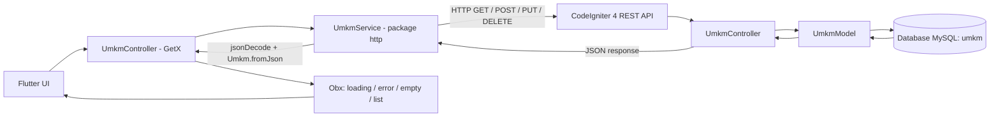

# Alur Integrasi Flutter dan REST API CI4

Alur data GET: Flutter meminta daftar UMKM, CI4 membaca database melalui Model, lalu mengirim response JSON. Service melakukan decoding dan `Umkm.fromJson()` mengubah tiap object JSON menjadi model Dart. Controller memperbarui state GetX sehingga UI membangun ulang daftar.

Alur data POST: pengguna mengisi form Flutter, controller memanggil service, service mengirim body form-urlencoded, CI4 memvalidasi data dan menyimpan ke tabel, lalu mengembalikan response JSON. Controller memuat ulang daftar agar UI menampilkan record yang tersimpan.
